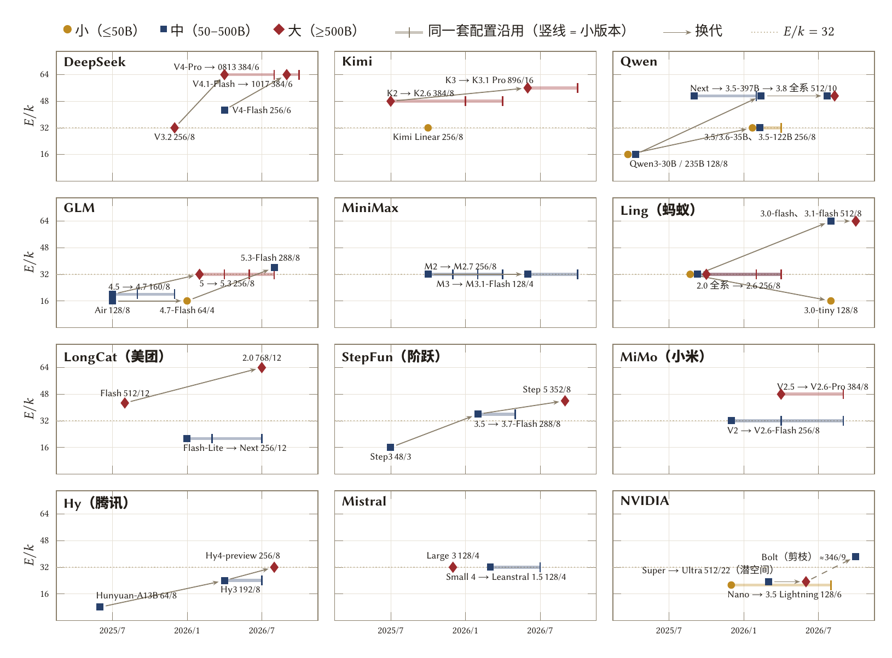
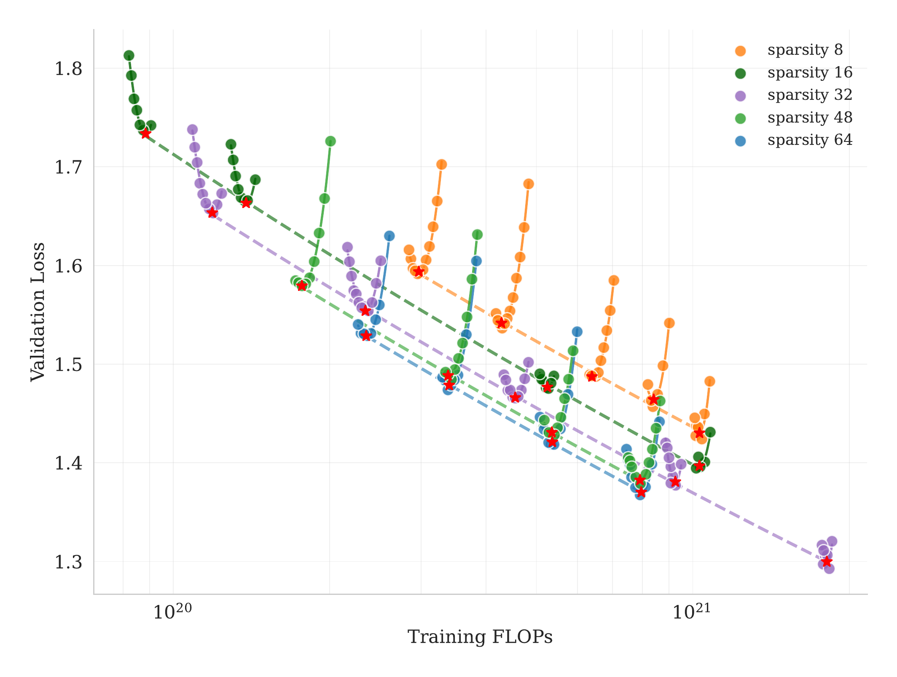
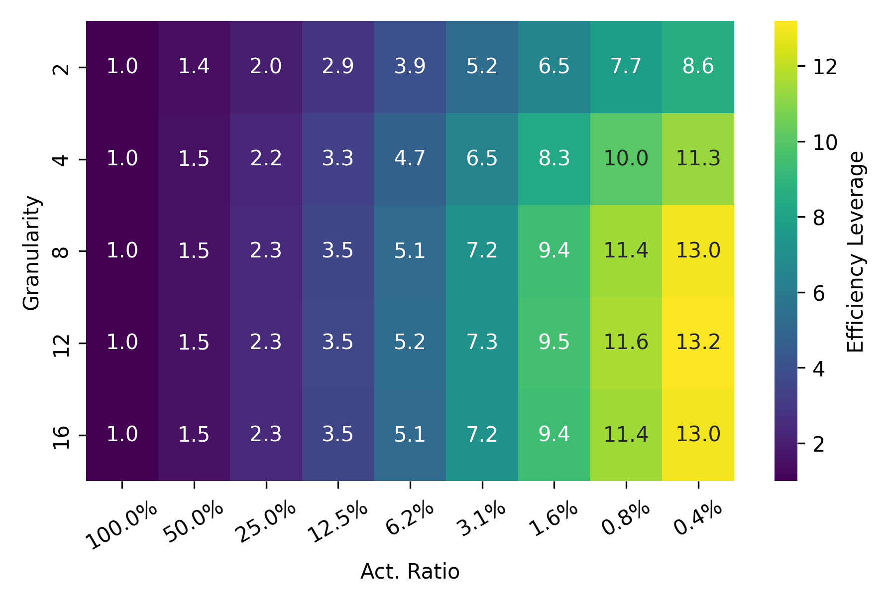
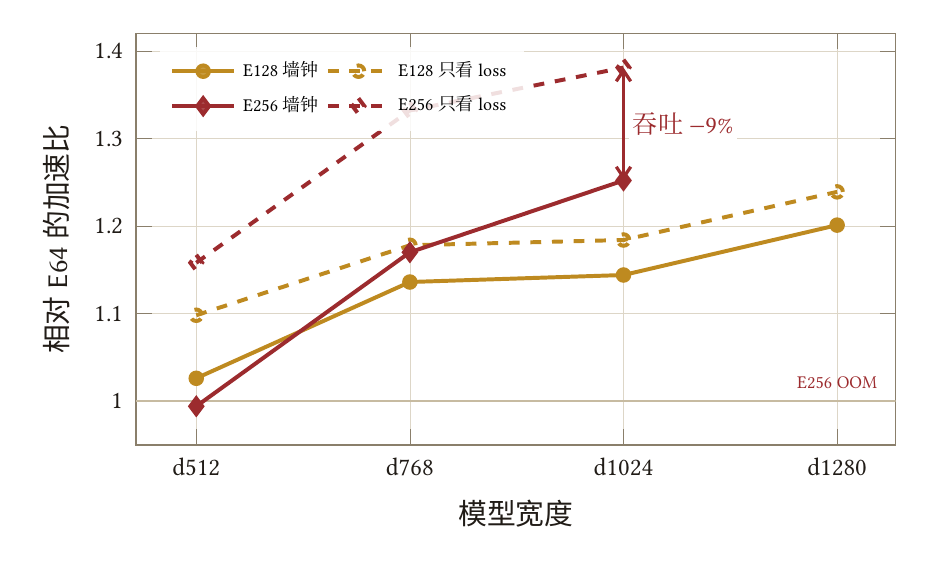

## MoE

标准的 `top-k` MoE 层把单个前馈网络拆成 $E$ 个路由专家（routed experts）外加 $s$ 个始终参与计算的共享专家（shared experts），每个 token 由 `router` 按亲和分数挑出 $k$ 个路由专家激活。总参数量随 $E$ 线性增长，每 token 的 FFN 计算量却只随 $k$ 和单个专家宽度 $d_{\text{expert}}$ 增长——两者拉开的比例，就是 MoE 设计里的第一个核心旋钮：**专家稀疏度**。

先给一句话结论：**固定每 token 计算量（FLOPs）时，把专家池做大、激活比例做低，预训练损失几乎单调变好**——这在 Kimi K2、蚂蚁 Ling、Apple 三组 scaling law 与我们在 `d512`、`d768` 小模型上跑出的 `E384 → E1536` 对照里一致成立。真正拦住稀疏度的不是模型质量，而是四笔系统账：总参数显存上限、解码时每个专家分到的 token 数 $T_{\text{exp}} = Tk/E$ 过少导致的带宽瓶颈、专家并行（EP）的 `all-to-all` 通信，以及数百上千专家下的负载均衡与自定义算子边界。

---

### 先对齐口径：三个「稀疏度」与专家粒度

同一个 MoE 模型，文献和模型卡里常见的三种说法会给出差很多的数值，读报告或对表前必须先对齐口径：

| 口径 | 定义 | DeepSeek-V3.2（`256/8+1`） | 适用场景 |
| --- | --- | --- | --- |
| 路由稀疏度 $E/k$ | 路由专家总数 / 每 token 激活的路由专家数（Kimi K2 报告里的 sparsity） | $256 / 8 = 32$ | 比较 `router` 从多大的池子里挑几个 |
| 专家激活比 $A$ | $(k + s) / (E + s)$，把共享专家按同宽计入（Ling 系列的 activation ratio） | $9 / 257 = 3.5\%$ | 衡量 MoE 层内部实际动用了多大比例的参数 |
| 参数激活比 $N_a / N$ | 每 token 激活参数 / 全模型总参数（含注意力、词嵌入、输出头与稠密层） | $37\text{B} / 671\text{B} = 5.5\%$ | 核算推理时的真实「计算 / 显存」比 |

此外，Apple（Abnar et al., 2025）定义的 sparsity 指**未激活**专家的比例 $1 - k/E$，数值越接近 $1$ 越稀疏，和 $E/k$ 只是同一件事的两种写法。

$E/k$ 和 $A$ 只看 MoE 层本身；$N_a / N$ 才会把注意力、词嵌入 / LM head、前几层稠密 FFN 和共享专家这些「每个 token 都逃不掉」的参数算进来。因此 $A$ 压到 $2\%$ 的大模型，$N_a / N$ 往往仍在 $3.5\%\text{–}4.5\%$；而在总参数 $\le 50\text{B}$ 的小模型上，词表与注意力占比更高，$A \approx 3.5\%$ 对应的整网激活比常常落在 $8\%\text{–}15\%$。

与「激活多少」正交的另一个旋钮是**专家粒度（granularity）**。Ling 团队（Tian et al., 2025）将其定义为：

$$
G = \frac{2\,d_{\text{model}}}{d_{\text{expert}}}
$$

在总参数与激活参数都固定时，$G$ 越大意味着单个专家越窄、专家个数 $E$ 与激活个数 $k$ 按同比例切得越碎。$A$ 决定「每步动用多大比例的 FFN 参数」，$G$ 决定「这份参数切成多少块」。

---

### 开源模型实际怎么选（2025–2026）

把 Hugging Face 上 16 家团队在 2025–2026 年开源的约 80 个 MoE 权重（核对至 2026 年 10 月底）逐个扒一遍 `config.json`，剔除只更新后训练而未改架构的小版本（如 `K2 → K2.6`、`GLM-5 → 5.3`、`MiniMax-M2 → M2.7`），一共剩下 **51 种不同的 MoE 配置**。分别按「厂家换代」和「总参数分档」两个切面看，规律非常清晰。

#### 按产品线：换代基本只会更稀疏



从 12 条产品线的 20 个换代箭头里能直接读出四条趋势：

- **换代几乎单向变稀疏**：20 个换代箭头里，$E/k$ 上升 14 个、持平 5 个、下降仅 1 个（唯一变密的是总参数直接砍半的 `Ling-mini-2.0 16B → Ling-3.0-tiny 7.9B`，从 `256/8` 缩回 `128/8`）。
- **架构约一年一换，小版本只动后训练**：同一套 `config.json` 往往被后训练反复榨取半年到九个月，版本号变新不代表稀疏度变新。
- **主流扩法是钉住 $k=8$、只加 $E$**：Ling（`256/8 → 512/8`）、GLM（`160/8 → 256/8`）、阶跃（`48/3 → 288/8 → 352/8`）、腾讯混元（`64/8 → 192/8 → 256/8`）和小米 MiMo 走的都是这条路；DeepSeek-V4 是唯一在加 $E$ 的同时把 $k$ 从 `8` 降到 `6` 的旗舰（`384/6+1`，$E/k=64$）。
- **少数模型刻意走 $k=4$ 的粗专家路线**：MiniMax-M3 把 M2 的 `256/8` 改成 `128/4+1`（同时把 $d_{\text{model}}$ 和专家宽度翻倍），Mistral 的 `675B / 119B` 和 OpenAI 的 `gpt-oss` 也停在 $k=4$、$E/k=32$。注意 `all-to-all` 的通信字节正比于 $k\,d_{\text{model}}$：MiniMax-M3 的 $4 \times 6144$ 与 M2 的 $8 \times 3072$ 乘积完全相等，它省下的不是跨卡通信字节，而是每 token 的派发次数与路由开销。

#### 按规模分档：小模型为什么没跟着变稀疏

把这 51 种配置按总参数切成**小档（$\le 50\text{B}$）**、**中档（$50\text{–}500\text{B}$）**、**大档（$\ge 500\text{B}$）**三组，同一家的大模型和小模型往往用两套截然不同的稀疏度（例如 Qwen 的 `35B` 用 `256/8`，`397B–2.4T` 用 `512/10`；Ling 的 `7.9B` 用 `128/8`，`124B–560B` 用 `512/8`）：

 参数激活比 N_a/N 随总参数下降，黑线为 log-log 拟合 N_a ≈ 0.23 N^0.76（R² = 0.89）；(b) 路由稀疏度 E/k，虚线与实线分别为各档在 2025 年与 2026 年的中位数。")

| 档位 | 配置数 | 激活参数 $N_a$ | 最常见配置 | $E/k$ 中位（范围） | $E/k$ 中位 `2025 → 2026` | $A$ 中位 | $N_a/N$ 中位（范围） |
| --- | --- | --- | --- | --- | --- | --- | --- |
| 小（$\le 50\text{B}$） | 10 | 1.3–3.8B | `128/6–8`、`256/8` | 16（8–32） | `19 → 16` | 6.6% | 11%（6%–17%） |
| 中（$50\text{–}500\text{B}$） | 24 | 3–47B | `256/8`、`512/10`、`128/4` | 32（8–64） | `20 → 36` | 3.5% | 5.6%（3.8%–16%） |
| 大（$\ge 500\text{B}$） | 17 | 16–104B | `256/8`、`384/6–8`、`512/8` | 44（23–64） | `32 → 50` | 2.3% | 4.5%（2.9%–10%） |

这里有三条对设计小模型尤其关键的事实：

1. **整网激活参数按幂律「定价」**：全部 51 个点拟合并拢在 $N_a \approx 0.23\,N^{0.76}$（$R^2 = 0.89$）附近——总参数每放大 $10$ 倍，参数激活比大约降到原来的 $0.58$（`30B` 时约 $10\%$，`300B` 约 $6\%$，`1T` 约 $4.5\%$，`3T` 约 $3.4\%$）。
2. **2026 年变稀疏的只有中档和大档，50B 以下的小档没动**：中档 $E/k$ 中位数从 `20` 涨到 `36`，大档从 `32` 涨到 `50`（DeepSeek-V4、Ling 3.x、LongCat-2.0 都到了 `64`），而小档中位数停在 `16`，上限不超过 `32`。原因不是小模型上稀疏没收益，而是两头被卡死了——总参数 $N$ 必须塞进单张消费级显卡或端侧统一内存（通常压在 `30B–35B` 以内），激活参数又很难压到 `1.3B–3B` 以下，算术上就把 $E/k$ 夹在了 `16–32`；再加上端侧 `batch = 1` 解码时每专家本来只分到几个 token，继续切碎也换不来吞吐。
3. **跨档放大靠的是加专家个数，而不是把单个专家切得更碎**：标准 `top-k` MoE 的粒度 $G$ 在小、中、大三档都落在 `2–8`（大档多为 `6–8`，14 个大档标准 MoE 里有 9 个专家宽度刚好是 `2048`）。模型变宽时，专家宽度跟着 $d_{\text{model}}$ 同步放大，多出来的预算花在增加 $E$ 上。

<details>
<summary>展开 2025–2026 开源 MoE 稀疏度全表（51 种配置）</summary>

配置写作 `E/k+s`（路由专家数 / 每 token 激活数 + 共享专家数），$G = 2d_{\text{model}}/d_{\text{expert}}$；潜空间路由或非标准专家形态的 $G$ 留空。

| 厂家 | 型号（同配置后续版本） | 首发 | 总 / 激活参数 | 配置 | $E/k$ | $A$ | $N_a/N$ | $G$ |
| --- | --- | --- | --- | --- | --- | --- | --- | --- |
| DeepSeek | DeepSeek-V3.2 | 2025.12 | 671B / 37B | `256/8+1` | 32 | 3.5% | 5.5% | 7 |
| DeepSeek | DeepSeek-V4-Flash | 2026.04 | 284B / 13B | `256/6+1` | 42.7 | 2.7% | 4.6% | 4 |
| DeepSeek | DeepSeek-V4-Pro（-0813） | 2026.04 | 1.6T / 49B | `384/6+1` | 64 | 1.8% | 3.1% | 4.7 |
| DeepSeek | DeepSeek-V4.1-Flash（-1017，另挂 196B Engram） | 2026.09 | 552B / 16B | `384/6+1` | 64 | 1.8% | 2.9% | 4.4 |
| Kimi | Kimi K2（K2.5、K2.6） | 2025.07 | 1.04T / 32B | `384/8+1` | 48 | 2.3% | 3.1% | 7 |
| Kimi | Kimi Linear 48B-A3B | 2025.10 | 48B / 3B | `256/8+1` | 32 | 3.5% | 6.2% | 4.5 |
| Kimi | Kimi K3（K3.1 Pro，潜空间路由） | 2026.06 | 2.78T / 104B | `896/16+2` | 56 | 2.0% | 3.7% | — |
| Qwen | Qwen3-30B-A3B | 2025.04 | 30.5B / 3.3B | `128/8` | 16 | 6.2% | 10.8% | 5.3 |
| Qwen | Qwen3-235B-A22B | 2025.04 | 235B / 22B | `128/8` | 16 | 6.2% | 9.4% | 5.3 |
| Qwen | Qwen3-Next-80B-A3B（Coder-Next） | 2025.09 | 80B / 3B | `512/10+1` | 51.2 | 2.1% | 3.8% | 8 |
| Qwen | Qwen3.5-35B-A3B（Qwen3.6-35B-A3B） | 2026.02 | 35B / 3B | `256/8+1` | 32 | 3.5% | 8.6% | 8 |
| Qwen | Qwen3.5-122B-A10B | 2026.02 | 122B / 10B | `256/8+1` | 32 | 3.5% | 8.2% | 6 |
| Qwen | Qwen3.5-397B-A17B | 2026.02 | 397B / 17B | `512/10+1` | 51.2 | 2.1% | 4.3% | 8 |
| Qwen | Qwen3.8-Flash-Next（另挂 n-gram 嵌入） | 2026.08 | 125B / 6B | `512/10+1` | 51.2 | 2.1% | 4.8% | 8 |
| Qwen | Qwen3.8-2.4T-A95B | 2026.08 | 2.4T / 95B | `512/10+1` | 51.2 | 2.1% | 4.0% | 8 |
| GLM | GLM-4.5-Air | 2025.07 | 106B / 12B | `128/8+1` | 16 | 7.0% | 11.3% | 5.8 |
| GLM | GLM-4.5（4.6、4.7） | 2025.07 | 355B / 32B | `160/8+1` | 20 | 5.6% | 9.0% | 6.7 |
| GLM | GLM-4.7-Flash | 2026.01 | 30B / 3B | `64/4+1` | 16 | 7.7% | 10.0% | 2.7 |
| GLM | GLM-5（5.1、5.2、5.3） | 2026.02 | 744B / 40B | `256/8+1` | 32 | 3.5% | 5.4% | 6 |
| GLM | GLM-5.3-Flash | 2026.08 | 320B / 18B | `288/8+1` | 36 | 3.1% | 5.6% | 4 |
| MiniMax | MiniMax-M2（M2.1、M2.5、M2.7） | 2025.10 | 230B / 10B | `256/8` | 32 | 3.1% | 4.3% | 4 |
| MiniMax | MiniMax-M3（M3.1-Flash） | 2026.06 | 428B / 23B | `128/4+1` | 32 | 3.9% | 5.4% | 4 |
| 蚂蚁 Ling | Ling-mini-2.0 | 2025.09 | 16.3B / 1.4B | `256/8+1` | 32 | 3.5% | 8.6% | 8 |
| 蚂蚁 Ling | Ling-flash-2.0（Ling-2.6-flash） | 2025.09 | 103B / 6.1B | `256/8+1` | 32 | 3.5% | 5.9% | 8 |
| 蚂蚁 Ling | Ling-1T（Ling-2.5-1T、2.6-1T） | 2025.10 | 1T / 50B | `256/8+1` | 32 | 3.5% | 5.0% | 8 |
| 蚂蚁 Ling | Ling-3.0-tiny | 2026.08 | 7.9B / 1.3B | `128/8+1` | 16 | 7.0% | 16.5% | 6 |
| 蚂蚁 Ling | Ling-3.0-flash | 2026.08 | 124B / 5.1B | `512/8+1` | 64 | 1.8% | 4.1% | 6.7 |
| 蚂蚁 Ling | Ling-3.1-flash | 2026.10 | 560B / 25B | `512/8+1` | 64 | 1.8% | 4.5% | 6.4 |
| 美团 LongCat | LongCat-Flash（含零计算槽位） | 2025.08 | 560B / 27B | `512/12` | 42.7 | 2.3% | 4.8% | 6 |
| 美团 LongCat | LongCat-Flash-Lite（Next） | 2026.01 | 68.5B / 3B | `256/12` | 21.3 | 4.7% | 4.4% | 6 |
| 美团 LongCat | LongCat-2.0 | 2026.07 | 1.6T / 48B | `768/12` | 64 | 1.6% | 3.0% | 8 |
| 阶跃 Step | Step3 | 2025.07 | 316B / 38B | `48/3+1` | 16 | 8.2% | 12.0% | 2.8 |
| 阶跃 Step | Step-3.5-Flash（3.7-Flash） | 2026.02 | 196B / 11B | `288/8+1` | 36 | 3.1% | 5.6% | 6.4 |
| 阶跃 Step | Step-5-Preview | 2026.09 | 600B / 27B | `352/8+1` | 44 | 2.5% | 4.5% | 5.3 |
| 小米 MiMo | MiMo-V2-Flash（V2.5、V2.6-Flash） | 2025.12 | 309B / 15B | `256/8` | 32 | 3.1% | 4.9% | 4 |
| 小米 MiMo | MiMo-V2.5-Pro（V2.6-Pro） | 2026.04 | 1.02T / 42B | `384/8` | 48 | 2.1% | 4.1% | 6 |
| 腾讯 Hy | Hunyuan-A13B | 2025.06 | 80B / 13B | `64/8+1` | 8 | 13.8% | 16.2% | 2.7 |
| 腾讯 Hy | Hy3（Hy3-preview） | 2026.04 | 295B / 21B | `192/8+1` | 24 | 4.7% | 7.1% | 5.3 |
| 腾讯 Hy | Hy4-preview | 2026.08 | 770B / 49B | `256/8+1` | 32 | 3.5% | 6.4% | 6 |
| Mistral | Mistral Large 3 | 2025.12 | 675B / 41B | `128/4+1` | 32 | 3.9% | 6.1% | 3.5 |
| Mistral | Mistral Small 4（Leanstral 1.5） | 2026.03 | 119B / 6.5B | `128/4+1` | 32 | 3.9% | 5.5% | 4 |
| NVIDIA | Nemotron 3 Nano（3.5 Lightning） | 2025.12 | 30B / 3.5B | `128/6+1` | 21.3 | 5.4% | 11.7% | 2.9 |
| NVIDIA | Nemotron 3 Super（潜空间路由） | 2026.03 | 120B / 12B | `512/22+1` | 23.3 | 4.5% | 10.0% | — |
| NVIDIA | Nemotron 3 Ultra（潜空间路由） | 2026.06 | 550B / 55B | `512/22+1` | 23.3 | 4.5% | 10.0% | — |
| NVIDIA | Nemotron 3.5 Bolt（逐层剪枝均值） | 2026.10 | 74B / 9B | `≈346/9+1` | 38.4 | 2.9% | 12.2% | — |
| OpenAI | gpt-oss-20b | 2025.08 | 21B / 3.6B | `32/4` | 8 | 12.5% | 17.1% | 2 |
| OpenAI | gpt-oss-120b | 2025.08 | 117B / 5.1B | `128/4` | 32 | 3.1% | 4.4% | 2 |
| Google | Gemma 4 26B-A4B | 2026.03 | 25.2B / 3.8B | `128/8+1` | 16 | 7.0% | 15.1% | 8 |
| Meta | Muse Spark Open | 2026.09 | 816B / 42B | `256/8` | 32 | 3.1% | 5.1% | — |
| 百度 ERNIE | ERNIE-4.5-21B-A3B | 2025.06 | 21B / 3B | `64/6+2` | 10.7 | 12.1% | 14.3% | 3.3 |
| 百度 ERNIE | ERNIE-4.5-300B-A47B | 2025.06 | 300B / 47B | `64/8` | 8 | 12.5% | 15.7% | 4.6 |

</details>

<details>
<summary>展开从 config.json 归一化读取 (E, k, s) 与每专家 token 数的脚本</summary>

各家 Hugging Face `config.json` 的字段名并不统一，下面几行可以把常见命名归一成 `(E, k, s)`，并直接算出 $E/k$、$A$ 以及一层 $T$ 个 token 均匀路由时每个专家分到的 token 数：

```python
def moe_shape(cfg: dict):
    """从 Hugging Face config.json 提取 (E, k, s, d_model, d_expert)。"""
    c = cfg.get("text_config", cfg)
    pick = lambda *keys: next((c[key] for key in keys if c.get(key)), 0)
    E = pick("n_routed_experts", "num_experts", "num_local_experts", "moe_num_experts")
    k = pick("num_experts_per_tok", "num_experts_per_token", "moe_topk", "moe_top_k")
    s = pick("n_shared_experts", "num_shared_experts")
    if not s and pick("shared_expert_intermediate_size", "share_expert_dim"):
        s = 1
    d_model = c["hidden_size"]
    d_exp = pick("moe_intermediate_size", "expert_ffn_hidden_size", "ffn_hidden_size")
    return E, k, s, d_model, d_exp

def summarize_moe(name: str, cfg: dict, tokens_per_step: int = 4096) -> str:
    E, k, s, d, d_exp = moe_shape(cfg)
    A = (k + s) / (E + s)
    t_exp = tokens_per_step * k / E
    G = f"{2 * d / d_exp:.1f}" if d_exp else "--"
    return f"{name:<24} E={E:>4} k={k:>2} s={s}  E/k={E/k:>5.1f}  A={A:>5.1%}  T_exp={t_exp:>5.0f}  G={G}"
```

</details>

---

### 为什么越稀疏越好：三组 scaling law

在 FLOPs 口径下，为什么把专家池做大就能白赚预训练质量？2025 年三组独立的 scaling law 从不同优化器、不同规模约束给出了相互印证的答案。

#### Kimi K2：固定激活，只扩专家池

:::lit[Muon 下固定激活 8+1 个专家，E/k 从 8 扩到 64 时验证损失持续下降]
Kimi Team（2025，§2.3）在 Muon 优化器下做了一组干净的受控扫描：每 token 固定激活 $8$ 个路由专家 + $1$ 个共享专家（每 token 计算量恒定），只把路由专家总数 $E$ 放大，使 $E/k$ 从 `8` 一路扫到 `64`。在计算最优前沿上，要达到验证损失 `1.5`，稀疏度 `48` 比 `8`、`16`、`32` 分别节省 **$1.69\times$、$1.39\times$、$1.15\times$** 的训练 FLOPs。K2 最终停在 $E/k = 48$（`384/8+1`），报告给出的理由非常直接：`64` 的拟合线还在略微往下走，但收益已经收窄，而基础设施复杂度在快速上升。
:::



#### 蚂蚁 Ling：效率杠杆 EL 与粒度二阶效应

蚂蚁 Ling 团队（Tian et al., 2025）训了 300 多个模型（最大 28B），先为 dense 和 MoE **各自拟合最优学习率、batch size 与模型 / 数据配比**，保证每个点都在各自调优后的状态下比较，再定义**效率杠杆（Efficiency Leverage）**为达到同一验证损失时 dense 与 MoE 所需的训练计算量之比：

$$
\mathrm{EL}(\mathcal{X}_{\text{MoE}} \mid \mathcal{X}_{\text{Dense}}) = \frac{C_{\text{dense}}}{C_{\text{moe}}}
$$

他们把激活比 $A$、专家粒度 $G$ 和计算预算 $C$ 合成为一条联合幂律：

$$
\mathrm{EL}(A, G, C) = \hat{A}^{\,\alpha + \gamma(\log G)^2 + \beta\log G}, \qquad \alpha = a + d\log C
$$

其中 $\hat{A}$ 是对 $A$ 的边界饱和变换（保证 $A \to 1$ 时 $\mathrm{EL} \to 1$）。从这条公式和热力图能拆出四条直接可用的设计结论：

1. **激活比 $A$ 是第一主效应**：固定每 token 计算量，把专家池从 `2` 扩到 `256`（$A$ 从 $100\%$ 降到 $0.8\%$），损失单调下降，$\mathrm{EL}$ 随 $A$ 呈幂律增长。
2. **粒度 $G$ 只是平坦的二阶修正**：损失对 $G$ 呈浅 U 形，最优区在 **$G \in [8, 12]$**，且不随计算预算漂移；但如果路由负载不均衡，最优点会被推向更粗的专家（更小的 $G$）。
3. **训练预算越大，稀疏杠杆越高**：同一套稀疏架构在更大 FLOPs 预算 $C$ 下，$\mathrm{EL}$ 会继续放大。
4. **共享专家给 1 个就够**：共享专家占比同样呈 U 形，预算超过 $10^{20}$ FLOPs 后，最优点落在最小的非零值——也就是留 `1` 个共享专家兜底共性特征，其余预算全给路由专家。



:::lit[Ling 在 0.85B 激活的小模型上实测兑现了约 7× 的训练 FLOPs 杠杆，但最优 batch size 更大]
按上述公式在 $10^{22}$ FLOPs 下预测，$A = 3.1\%$、$G = 12$ 的 $\mathrm{EL} > 7$。Ling 团队据此训练了 `Ling-mini-beta`（`0.85B` 激活 / `17.5B` 总参数），在 1T token 后与同配方训出的 `6.1B` 稠密模型打平略优（Ling Team, 2025）。同时他们指出一条极易在超参迁移时踩坑的规律：**同算力下 MoE 的最优 batch size 显著大于 dense，最优学习率略低**——因为每个路由专家每步只看到全局 batch 里约 $k/E$ 比例的 token，专家参数上的梯度噪声比稠密参数大得多，且越稀疏越明显。
:::

#### Apple：总参数封顶时存在最优稀疏度

前面两组扫描默认「总参数 $N$ 可以随稀疏度自由膨胀」。Apple 团队（Abnar et al., 2025）补上了另一半约束——如果设备的显存把**总参数 $N$ 锁死**了，还会越稀疏越好吗？

- **不限总参数时**：提高稀疏度并同步放大总参数，预训练损失一路下降，且计算最优的激活参数量 $N_a^*$ 会随稀疏度提高而变小。
- **固定总参数 $N$ 时**：损失关于稀疏度变成**开口向上的抛物线**。当总参数相对训练 token 预算偏小时，把固定大小的参数池切得太稀疏（每步只激活极小一撮）反而伤质量；只有总参数充裕、训练预算也大时，最优稀疏度才会逼近上限。
- **下游任务并非只看预训练 loss**：绝大多数评测只跟预训练损失走，但在阅读理解（CoQA、SQuAD）这类需要当场整合上下文的任务上，**同一预训练 loss 下更稠密的模型表现更好**——每 token 实打实花掉的推理计算量仍然有独立作用。

---

### 小模型一手实验：d512 与 d768 上的 E384 → E1536

文献里的 scaling law 多在标准路由稀疏度 $E/k \le 64$ 范围内拟合。在更小的激活规模上，如果继续把专家池推到上千个（$E/k > 150$），按相同训练 FLOPs 对齐还能不能继续降损失？同样的计算预算，拿去**加专家**和拿去**加宽残差流**哪个更划算？

我们在 4 张 Ascend 910C（8 个逻辑 die，`EP8`）上基于 Marin 小档位配方跑了一组受控对照（分项实验流水见页末[挂在这一章下的观察](#notes)）。共同设置：`top-10` 路由 + `1` 个共享专家，注意力为 KDA 与全局 MLA 按 `2 : 1` 混合，分位数均衡（QB），`global batch = 128`，序列长度 `4096`，单 `seed 0`。由于专家数增加会让 `router` 等每 token 解析 FLOPs 略升几个百分点，处理组按**相同总代理 FLOPs** 对齐（相应少训一点 token，学习率与优化器 $\epsilon$ 按各自 token 预算套同一条 Marin 经验公式），终点评测全量 packed Paloma 16 域的宏平均 BPB（越低越好）。

#### 同 FLOPs 扩专家池，以及「稀疏 vs. 加宽」

| 档位（总解析 FLOPs） | 臂 | 总参数 | 训练 token | 分发方式 | Paloma BPB | 相对对照 Δ |
| --- | --- | --- | --- | --- | --- | --- |
| `d512×6`（`1.135e18`） | `E384`（历史基线） | 5.02 亿 | 4.62B | 容量系数 1.05（末次丢弃 9.4%） | 1.2266 | — |
| `d512×6`（`1.135e18`） | `E384`（v23 干净基线） | 5.02 亿 | 4.62B | `dropless` | 1.2209 | — |
| `d512×6`（`1.135e18`） | `E768` | 9.56 亿 | 4.50B | `dropless` | 1.2080 | −1.51%（对历史）/ −1.06%（对 v23） |
| `d512×6`（`1.135e18`） | `E1536` | 18.64 亿 | 4.26B | `dropless` | **1.1986**（v23 版 **1.1984**） | 在 `E768` 上再降 **−0.78%** |
| `d512` 同预算跨形状 | `d768×8 E384` | 14.52 亿 | 1.90B | `dropless` | 1.2148 | 比同 FLOPs 的 `d512 E1536` 差 **+1.35%** |
| `d768×8`（`7.831e18`） | `E384` | 14.52 亿 | 13.10B | `dropless` | 1.1281 | — |
| `d768×8`（`7.831e18`） | `E1536` | 55.36 亿 | 12.24B | `dropless` | **1.1099**（v23 版 **1.1097**） | **−1.62%** |

这里有两个细节需要在读表时分开看：第一，早期 `d512 E384 → E768` 的 `−1.51%` 同时包含了「专家数翻倍」和「去掉容量系数 1.05 的 9.4% token 丢弃（改成 `dropless`）」两件事；但拿后来补跑的同配方 `dropless E384`（`1.2209`）作干净基准，`E384 → E768 → E1536` 依然在少吃 token 的前提下给出了连续、单调的净收益（累计 **−1.84%**），而且 16 个评测域全部变好，其中 `Code` 域降幅最大。第二，在 `d768×8`（全程 `dropless`）上从 `E384` 直接扩到 `E1536`（$E/k = 153.6$），BPB 降了 **−1.62%**，比 `d512` 上的边际收益还略大一点，与 Ling「预算越大，稀疏杠杆越高」的方向一致。

:::obs[同训练 FLOPs 下，扩专家池（d512 E1536）全面赢过加宽主干（d768 E384），但纯墙钟账未必]
把 `d768×8 E384` 压到和 `d512×6 E1536` 完全相同的 `1.135e18` 训练 FLOPs（只够跑 3624 步、1.90B token），终点 Paloma BPB 为 `1.2148`，比 `d512 E1536`（`1.1986`）差 `+1.35%`，16 个子域无一例外全部更差。这说明在纯计算预算口径下，花同样多的 FLOPs，堆稀疏专家容量比加宽残差流划算得多——特别是宽模型在短 token 预算下还没训透。但必须同时记下另一面：在同一套未专门重调的内核与 microbatch 下，`d512 E1536` 跑完同样 FLOPs 花掉的 NPU 墙钟时间是 `1.79×`，高于其 loss 领先折算出的约 `1.44×` 计算等效比；如果按「固定卡时」重比，胜负很可能会反过来。
:::

#### 层间怎么分、能不能用 N-gram 表替掉一半专家

既然专家总数这么值钱，顺着往下自然会问两个问题：**总专家数不变时，把专家往后层集中会不会更好？能不能用免计算的输入端 N-gram 查表替掉一半路由专家？** 我们在 `d512×6` 上把这两条路都实测了一遍：

:::obs[总专家数固定时，均匀分到每一层最好；输入端 N-gram 表替不掉一半专家]
1. **层间非均匀分配没有收益**：固定 `d512×6` 全网共 `2304` 个路由专家（总参数 5.02 亿、4.62B token、FLOPs 完全一致），均匀分法（6 层各 `384`）BPB 为 `1.2209`；「前疏后密」（前 4 层 `288`、后 2 层 `576`）为 `1.2219`（`+0.08%`）；「前密后疏」（前 2 层 `576`、后 4 层 `288`）为 `1.2227`（`+0.15%`）。两种倾斜分配都没跑赢最简单的逐层均分。
2. **输入端 N-gram 查表只追回约三分之一的专家收益**：保持总参数（`18.64 亿`）与总解析 FLOPs 完全一致，把 `E1536` 砍半成 `E768`，省下的 `9.08 亿`参数换成输入端双头 2/3-gram 嵌入表（`E768 + N-gram`）。终点 Paloma BPB 为 `1.2047`，16 个域全部输给纯 `E1536`（`1.1984`，差 `+0.53%`），只比纯 `E768`（`1.2080`）好 `−0.27%`——静态表面 n-gram 记忆只能替代小部分浅层模式，换不回深层按上下文动态路由的非线性专家容量。
:::

---

### 稀疏的工程账单：为什么不能无脑拉满

所有幂律都在 FLOPs 坐标系里画线，但硬件收钱看的是显存容量、HBM 带宽、跨节点网卡和算子启动开销。这四笔账全都随着 $E$ 或 $E/k$ 增大而恶化。

#### 解码算术强度：每专家分到的 token 太少

设一层同时处理 $T$ 个 token，在理想均匀路由下，每个路由专家平均分到的 token 数为：

$$
T_{\text{exp}} = \frac{T\,k}{E}
$$

分组矩阵乘（grouped GEMM）的算术强度（FLOPs / Byte）随 $T_{\text{exp}}$ 近似线性增长，直到跨过硬件的 Roofline 拐点、把读取专家权重的 HBM 带宽开销摊薄为止。Elango et al.（2026）以 GB200（FP4）上的 `Qwen3-235B-A22B` 为例算过一笔账：要让专家 GEMM 进入算力瓶颈，**每个专家至少要分到约 `1418` 个 token**；而在线交互解码的全局并发 batch 往往只有几百，此时专家层完全卡在**内存带宽瓶颈**上，耗时取决于「这一步一共从 HBM 里搬了多少份专家权重」。

把稀疏度 $E/k$ 翻一倍，同等并发 $T$ 下的 $T_{\text{exp}}$ 就直接腰斩。哪怕在 $T = 4096$ 的大并发或单序列预填充下，`256/8`（$E/k = 32$）每专家能分到 `128` 个 token，到了 `512/8` 或 `384/6`（$E/k = 64$）就只剩 `64` 个；而在端侧 `batch = 1` 解码（$T = 1$）时，激活 $k$ 个专家就得实打实读 $k$ 份专家权重，再大的专家池也省不下一字节带宽。

#### 训练吞吐与显存墙：FLOPs 等效不等于墙钟等效

训练阶段 $T$ 往往有几十万（例如 `global batch 128 × 4096 = 524,288`），看似不缺 token，但一旦用 EP 把专家拆到多张卡上，每张卡本地处理的 token 池变小，路由排序、排列（permute / unpermute）、分组 GEMM 切分与优化器状态遍历的固定开销就会吃掉吞吐。

Marin 社区的 Grug MoE 实验（issue `#5387`）把这笔「FLOPs 收益被吞吐吃回去」的账画得最直观：固定 `top-4`，把路由专家从 `64` 加到 `128`、`256`（$E/k$ 从 `16` 到 `64`），同时对比「只看 loss 换算的等效加速」与「乘上实测吞吐后的墙钟等效加速」：



- **小宽度上吞吐掉的比质量赚的多**：`E256` 相对 `E64` 的纯 loss 等效加速从 `d512` 的 `1.16×` 涨到 `d1024` 的 `1.38×`，但实测吞吐掉了 `9%–14%`，导致 `d512` 上的墙钟加速只剩 **`0.994×`**（白忙活），要放大到 `d1024` 才有 **`1.25×`** 的净墙钟收益。我们在 `d1024×12` 上把组合配方扩到 `E1536` 时也看到了同样的现象：同总 FLOPs 下，总参数从 `38.1 亿`涨到 `148.1 亿`，训练墙钟时间多了约 **39%**。
- **显存会比算力先撞墙**：Marin 的 `E256` 在 `d1280` 第 0 步就直接因 256 份专家权重加优化器状态 OOM。虽然 Ludziejewski et al.（ICML 2025）证明在 $E \le 8$、拉长 $E$ 倍 token 过训练的小规模设定下 MoE 可以做到显存友好，但一旦进入 $E \ge 256$ 的现代细粒度区间，最小训练 / 部署卡数依然由总参数硬性决定。

:::pitfall[只按等 FLOPs 曲线挑稀疏度，会在小档位和上线推理时同时算错账]
小尺度 ablation 很容易得出「把 $E$ 再翻一倍还能降 0.8% BPB」的结论，但小模型单专家矩阵窄、硬件利用率（MFU）本来就低（我们在 910C 上测 `d768 E1536` 仅约 `8.7%` MFU，放大到 `d2048` 才升到 `14.1%`）。选型时一定要把判据从「等 FLOPs 的 loss」换成「**loss 折算的计算等效比 × 实测吞吐比**」，并按目标部署设备的显存上限和解码并发 $T$ 倒推 $E$ 的天花板。
:::

#### 专家并行通信拓扑约束了 $k$ 的上限

跨卡专家并行时，每个 token 的隐状态要按路由结果发往 $k$ 个专家所在的设备、算完再收回来，`all-to-all` 通信量正比于 $T\,k\,d_{\text{model}}$。当集群跨多个节点时，机间网络（IB / RoCE）带宽远低于机内互联（NVLink / HCCS）。

DeepSeek-V3（2024，§2.1.2）给出的解法是**节点受限路由（node-limited routing）**：先把专家按所在节点分成组，按每组内最高若干个亲和分数之和挑出最多 $M = 4$ 个目标节点，再只在这 $M$ 个节点内部挑满 $k$ 个专家（即 `config.json` 里的 `n_group = 8`、`topk_group = 4`，对应 Megatron-Core 的 `moe_router_num_groups` 与 `moe_router_group_topk`）。按 DeepSeek-V3 的带宽比测算，只要每个命中节点平均挑不超过 `3.2` 个专家就不会撑爆机内转发，从而在相同机间通信成本下把 $k$ 的无损上限推高到 `13`（实际取 `8`）。换句话说，**工程上 $k$ 能取多大，首先是由机间 / 机内带宽比决定的**。

#### 数百上千专家下的负载均衡与自定义算子边界

当路由专家数从 `64` 推到 `384`、`512` 乃至 `1536` 时，原本温和的工程细节会突然变成训练稳定性和正确性事故：

1. **偏置均衡步长失灵，需要分位数均衡（QB）**：无辅助损失（aux-loss-free）负载均衡靠给每个专家维护一个偏置项 $b_i$ 来调节冷热。专家越多，单专家的目标负载份额 $k/E$ 越小（`1536` 选 `10` 时仅 $0.65\%$），固定步长的符号更新很难同时兼顾「快速拉起冷专家」和「不在平衡点附近震荡」。换成**分位数均衡（Quantile Balancing）**——以每个 token 的第 $k+1$ 高分作为入选门槛，直接把每个专家的偏置一步卡到「恰好让目标数量 token 越过门槛」的经验分位数上——在 `E384` 到 `E1536` 上都能稳定做到 `dropless` 零丢弃且无死专家。
2. **分组矩阵乘与自定义内核的硬上限**：把 $E$ 拉到上千之前，必须逐一核对底层算子库的组数限制和索引位宽。

:::pitfall[专家数上千后，先查 GMM 最大组数上限与路由计数张量的 int32 溢出]
我们在 `E1536` 训练里连续撞上过两道算子硬墙：

- **Grouped GEMM 组数上限**：Ascend `aclnnGroupedMatmulV4` 的 `groupList` 单次最多只支持 `1024` 组；跑 `E1536` 时必须按连续专家编号拆成两次 `768` 组的 GMM 执行再按原序拼回（空半组跳过并保持零梯度）。
- **扁平索引跨过 $2^{31}$ 溢出**：在 `d1024×12`、`global batch = 256`（单步 `131,072` 个 token）、`E1536` 下，分位数均衡统计的张量形状变成 `[12, 131072, 1536]`，总元素数约 **24.2 亿**，刚好跨过有符号 32 位整数上限 $2^{31} - 1 \approx 21.5\text{ 亿}$。自定义计数内核里的 `int32` 扁平索引越界后，前 9 层看似正常，第 10、11 层的专家负载变异系数（CV）直接飙到 `3.69` 和 `5.24`。把索引改成 `int64` 后从断点续训 100 步内即可恢复正常（见页末[观察与踩坑记录](#notes)）。
:::

---

### 定稀疏度的实操清单

:::recipe[按这七步给标准 top-k MoE 定稀疏度]
1. **先按延迟与算力预算钉死激活参数 $N_a$，再按显存上限倒推总参数 $N$**：端侧或单卡部署的小模型（$N \le 50\text{B}$）通常落在 $N_a \approx 1.3\text{–}3.8\text{B}$、$E/k \in [16, 32]$（如 `128/8` 或 `256/8`）；服务端多卡模型（$N \ge 100\text{B}$）优先把 $E/k$ 推到 `32–64`。
2. **专家粒度 $G = 2d_{\text{model}}/d_{\text{expert}}$ 取 `6–12`，共享专家留 `1` 个**：跨规模放大时让 $d_{\text{expert}}$ 跟着 $d_{\text{model}}$ 同步变宽，多出来的参数预算优先加在专家个数 $E$ 上，不要把单个专家切得过窄。
3. **层间均匀分配专家**：总专家预算固定时，每一层放相同数量的路由专家即可，前疏后密或前密后疏在小模型实测里都没有正向收益。
4. **不要拿静态查表硬替专家池**：输入端 n-gram 表即使配齐相同总参数，也只能补回约三分之一的专家扩展收益；只有当目标是省激活显存带宽而非替代 MoE 时才单独作为外挂记忆考虑。
5. **用「loss 计算等效比 × 实测吞吐比」做小尺度选型**：拒绝只看等 FLOPs 的验证损失；同时把 MoE 的全局 batch size 设得比同算力稠密模型更大、学习率略微调低，抵消单专家只吃 $k/E$ 份额带来的梯度噪声。
6. **按目标服务形态核算 $T_{\text{exp}} = Tk/E$ 与跨节点路由**：确认常见解码并发 $T$ 下 $T_{\text{exp}}$ 不会让专家层彻底沦为权重读取器；跨多节点 EP 训练时打开分组 / 节点受限路由控制机间 `all-to-all`。
7. **专家数上到数百乃至上千时，升级均衡器并排查算子位宽**：优先采用 `dropless` 分发配合分位数均衡（QB），并在开跑前用真实全局形状做一次预检，排查分组 GEMM 的最大组数上限与所有自定义 Triton / Ascend C 内核的 `int64` 索引。
:::
